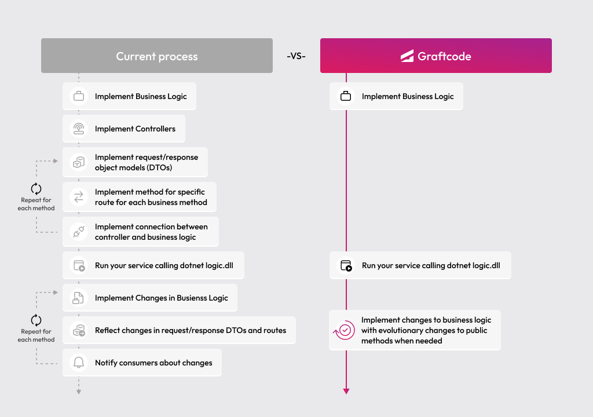

## Goal

Turn a PHP class into a remotely callable backend service using Graftcode Gateway - no Laravel routes, no REST controllers, no OpenAPI specs needed.

### What You'll See

- Create a small PHP class with public methods.
- Host it through Graftcode Gateway using Docker.
- Explore the exposed methods in Graftcode Vision - your service is now accessible from any app as a strongly-typed client.

### Prerequisites

- [Docker](https://docs.docker.com/get-docker/) installed and running
- [PHP 7.4 or 8.0+](https://www.php.net/downloads) and [Composer](https://getcomposer.org/) only if you run the Composer consumer locally - Docker alone is enough to build and host the service

## Step 1. Create a project folder

Create a new folder and set up a Composer project:

```bash
mkdir php-energy-service
cd php-energy-service
```

Create `composer.json`:

```json
{
    "name": "example/energy-service",
    "description": "Energy price sample module",
    "type": "library",
    "license": "ISC",
    "version": "1.0.0",
    "require": {
        "php": "^7.4 || ^8.0"
    },
    "autoload": {
        "psr-4": {
            "Energy\\": "src/"
        }
    }
}
```

## Step 2. Write a PHP class with public methods

Create `src/EnergyPriceCalculator.php`:

```php
<?php

declare(strict_types=1);

namespace Energy;

use Random\RandomException;

class EnergyPriceCalculator
{
    /**
     * @throws RandomException
     */
    public static function getPrice(): int
    {
        return random_int(100, 104);
    }
}
```

This is a plain PHP class - no attributes, no frameworks, no special interfaces. Any public method you write here will automatically become available for remote consumption once hosted through Graftcode Gateway.

## Step 3. Host it with Graftcode Gateway

Create a `Dockerfile` in the project root:

```dockerfile
FROM php:8.4-cli

WORKDIR /usr/app

COPY . /usr/app/

RUN apt-get update && apt-get install -y git unzip \
 && curl -sS https://getcomposer.org/installer | php -- --install-dir=/usr/local/bin --filename=composer \
 && composer install --no-dev --optimize-autoloader \
 && curl -fsSL grft.dev/get/gg | sh && dpkg -i gg.deb && rm gg.deb \
 && apt-get clean && rm -rf /var/lib/apt/lists/*

EXPOSE 80
EXPOSE 81

CMD ["gg", "/usr/app/src"]
```

The key line is the last one - `gg` (Graftcode Gateway) reads the module path under `--modules`, discovers all public methods in your PHP classes, and exposes them automatically. Port `80` handles service calls, port `81` serves Graftcode Vision.

<collapsible title="🐳 Understanding the Dockerfile - click to see what each line does">

- **FROM php:8.4-cli** - Uses the official PHP 8.4 CLI image as the base runtime environment.
- **COPY . /usr/app/** - Copies your project files (including `composer.json` and `src/`) into the container.
- **composer install --no-dev --optimize-autoloader** - Registers PSR-4 autoloading so Gateway can load your classes.
- **RUN curl -fsSL grft.dev/get/gg | sh && dpkg -i gg.deb && rm gg.deb** - `curl` downloads the installer, `dpkg -i gg.deb` installs Graftcode Gateway, and `rm gg.deb` removes the package.
- **EXPOSE 80** - Declares the port used for service communication (Grafts connect here).
- **EXPOSE 81** - Declares the port used by Graftcode Vision, the live portal for exploring and testing exposed methods.
- **CMD ["gg", "--modules", "/usr/app/src", "--runtime", "php"]** - Runs Graftcode Gateway against your `src/` directory with the PHP runtime. It discovers public methods and makes them callable. `--modules` is optional when the same directory as `gg` contains only one target module.

</collapsible>

Build and run the container:

```bash
docker build --no-cache --pull -t myenergyservice-php:test .
docker run -d -p 80:80 -p 81:81 --name graftcode_demo_php myenergyservice-php:test
```

Your PHP service is now running and exposed through Graftcode Gateway.

## Step 4. Explore the service in Graftcode Vision

Open [http://localhost:81/GV](http://localhost:81/GV) in your browser.

You will see all public methods from your PHP class - their names, parameter types, and return types. Graftcode Vision also provides:

- A **"Try it out"** button to call methods live, directly from the browser.
- A **package manager command** (npm, NuGet, PyPI, Composer, etc.) to install this service as a strongly-typed client in any other application.

## Step 5. Run with a Project Key (recommended for real-world usage)

Everything above works without any account - perfect for learning and local development. When you're ready for real-world usage, create a free account at [portal.graftcode.com](https://portal.graftcode.com), set up a project, and copy its **Project Key**.

Then pass the key when starting your gateway:

```dockerfile
CMD ["gg", "/usr/app/src", "--projectKey", "YOUR_PROJECT_KEY"]
```

A Project Key gives you:

- **Stable registry URL** - consumers always find and update your Graft through a permanent address, so install commands don't change when you redeploy.
- **Portal visibility** - see all your gateways and exposed services in one place at [gateways.graftcode.com](https://gateways.graftcode.com/).
- **Access control** - decide who can download your Grafts using package manager authentication and permissions.
- **MCP endpoint** - Graftcode Gateway automatically exposes an [MCP](https://modelcontextprotocol.io/) (Model Context Protocol) endpoint alongside your service, making your methods callable by AI agents and LLM-based tools out of the box.

## Step 6. Call it from another app

Your service is now accessible from any application. From Graftcode Vision, select your target package type - for example `Composer` - and copy the generated install command. That installs a **Graft**: a strongly-typed client that lets any app call your service methods directly.

Use the package name and import paths from Vision or Gateway logs (for this sample the package is typically `graft/composer-energy-service:1.0.0`). `getPrice()` is synchronous and returns an `int`:

```php
<?php

declare(strict_types=1);

require __DIR__ . '/vendor/autoload.php';

use Graft\Composer\EnergyService\EnergyPriceCalculator;
use Graft\Composer\EnergyService\GraftConfig;

GraftConfig::$host = 'ws://localhost:80/ws';

$price = EnergyPriceCalculator::getPrice();
echo sprintf('Energy price is: %d $', $price), PHP_EOL;
```

Always prefer the exact namespace, package id, and install command from Graftcode Vision - generated Composer Grafts mirror your hosted class names (often camelCase method names such as `getPrice`).

No REST clients, no request/response models, no endpoint URLs in your code. When you add or update a public method, consumers update their Graft with a single package manager command.

<collapsible title="Old Way vs New Way">

### Without Graftcode

Exposing backend logic for remote consumption typically requires:

- Designing and implementing REST or gRPC endpoints for each operation
- Defining request and response DTOs / schemas
- Writing or generating an OpenAPI / Protobuf spec
- Building or generating client SDKs for each consumer technology
- Maintaining and versioning the API contract over time
- Updating all clients whenever the backend changes

### With Graftcode

- Write your business logic as plain public methods - no frameworks, no routes, no specs
- Run it on Graftcode Gateway with one Dockerfile
- Consumers install a typed Graft via their package manager and call methods directly
- When you add or change a method, consumers update with one command - like any other dependency

> Your PHP class is now a fully accessible backend service - with one Dockerfile and two commands. Any public method you add is instantly discoverable and callable from any language and any platform. No endpoint design, no client SDK maintenance, no integration code.



</collapsible>
