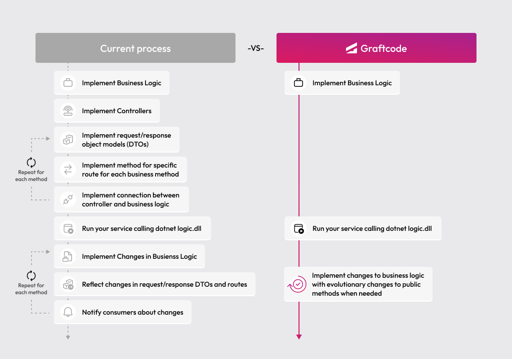

## Goal

Turn a Ruby library into a remotely callable backend service using Graftcode Gateway - no Sinatra or Rails routes, no REST controllers, no OpenAPI specs needed.

### What You'll See

- Create a small Ruby class with public class methods.
- Host it through Graftcode Gateway using Docker.
- Explore the exposed methods in Graftcode Vision - your service is now accessible from any app as a strongly-typed client.

### Prerequisites

- [Docker](https://docs.docker.com/get-docker/) installed and running
- [Ruby](https://www.ruby-lang.org/en/downloads/) and [Bundler](https://bundler.io/) only if you run the RubyGems consumer locally - Docker alone is enough to build and host the service

## Step 1. Create a project folder

Create a new folder and add a gemspec plus a `Gemfile` so Gateway can resolve dependencies the usual Ruby way:

```bash
mkdir ruby-energy-service
cd ruby-energy-service
```

Create `energy-service.gemspec`:

```ruby
# frozen_string_literal: true

Gem::Specification.new do |spec|
  spec.name = "energy-service"
  spec.version = "1.0.0"
  spec.authors = ["Example"]
  spec.summary = "Energy price sample module"
  spec.license = "MIT"
  spec.files = Dir["lib/**/*.rb"]
  spec.require_paths = ["lib"]
  spec.required_ruby_version = ">= 3.2.0"
end
```

Create `Gemfile`:

```ruby
# frozen_string_literal: true

source "https://rubygems.org"

gemspec
```

## Step 2. Write a Ruby class with public methods

Create `lib/energy_price_calculator.rb`:

```ruby
# frozen_string_literal: true

class EnergyPriceCalculator
  def self.get_price
    rand(100..104)
  end
end
```

This is plain Ruby - no frameworks, no special DSL. Any **public** class method you add here becomes available for remote consumption once hosted through Graftcode Gateway.

## Step 3. Host it with Graftcode Gateway

Create a `Dockerfile` in the project root:

```dockerfile
FROM ruby:3.3-bookworm

WORKDIR /usr/app

COPY . /usr/app/

RUN apt-get update && apt-get install -y --no-install-recommends ca-certificates curl \
 && curl -fsSL grft.dev/get/gg | sh && dpkg -i gg.deb && rm gg.deb \
 && bundle install \
 && apt-get clean && rm -rf /var/lib/apt/lists/*

ENV HYPERTUBE_RUBY_RUNTIME_PATH=/usr/local/lib/libruby.so

EXPOSE 80

CMD ["gg", ".", "--runtime", "ruby"]
```

The last line is the important one - `gg` (Graftcode Gateway) analyzes the module path, discovers public methods on your classes, and exposes them automatically. The **`--port` listener (default `80`) carries WebSocket traffic** (for example `ws://localhost:80/ws`) **and serves HTTP** for Graftcode Vision, MCP, and `/status` on the **same TCP port** (for example `http://localhost:80/GV`). Gateway also starts a **second HTTP listener on `--httpPort`** (default `81`); you can expose that too, but for this tutorial one host port is enough. `HYPERTUBE_RUBY_RUNTIME_PATH` points Hypertube at the MRI shared library inside the image, matching how Gateway hosts Ruby Receivers.

<collapsible title="🐳 Understanding the Dockerfile - click to see what each line does">

- **FROM ruby:3.3-bookworm** - Official Ruby 3.3 image with a full toolchain for `bundle install`.
- **COPY . /usr/app/** - Copies your `lib/`, `Gemfile`, and gemspec into the container.
- **bundle install** - Resolves gems so Gateway analyzes the same layout you use locally.
- **RUN curl -fsSL grft.dev/get/gg | sh && dpkg -i gg.deb && rm gg.deb** - Installs the Linux `gg` package for Graftcode Gateway.
- **ENV HYPERTUBE_RUBY_RUNTIME_PATH=/usr/local/lib/libruby.so** - Tells Hypertube where to load the Ruby runtime for cross-runtime bridges.
- **EXPOSE 80** - The default `--port`: WebSocket for Graft calls **and** HTTP for Vision (`/GV`), MCP (`/mcp`), and `GET /status` on the same listener.
- **CMD ["gg", ".", "--runtime", "ruby"]** - Runs Graftcode Gateway from `/usr/app` with `--runtime ruby`. The first argument is your hosted module path (the gem root, same idea as `bundle install` then hosting that folder — see [Run Gateway locally](https://academy.dev.graftcode.com/documentation)). `--modules` is optional when `gg` can infer a single target directory.

</collapsible>

Build and run the container:

```bash
docker build --no-cache --pull -t myenergyservice-ruby:test .
docker run -d -p 80:80 --name graftcode_demo_ruby myenergyservice-ruby:test
```

Your Ruby service is now running and exposed through Graftcode Gateway.

## Step 4. Explore the service in Graftcode Vision

Open [http://localhost:80/GV](http://localhost:80/GV) in your browser.

You will see all public methods from your Ruby class - their names, parameter types, and return types. Graftcode Vision also provides:

- A **"Try it out"** button to call methods live, directly from the browser.
- A **package manager command** (npm, NuGet, PyPI, Composer, RubyGems, and so on) to install this service as a strongly-typed client in any other application.

## Step 5. Run with a Project Key (recommended for real-world usage)

Everything above works without any account - perfect for learning and local development. When you're ready for real-world usage, create a free account at [portal.graftcode.com](https://portal.graftcode.com), set up a project, and copy its **Project Key**.

Then pass the key when starting your gateway:

```dockerfile
CMD ["gg", ".", "--runtime", "ruby", "--projectKey", "YOUR_PROJECT_KEY"]
```

A Project Key gives you:

- **Stable registry URL** - consumers always find and update your Graft through a permanent address, so install commands don't change when you redeploy.
- **Portal visibility** - see all your gateways and exposed services in one place at [gateways.graftcode.com](https://gateways.graftcode.com/).
- **Access control** - decide who can download your Grafts using package manager authentication and permissions.
- **MCP endpoint** - Graftcode Gateway automatically exposes an [MCP](https://modelcontextprotocol.io/) (Model Context Protocol) endpoint alongside your service, making your methods callable by AI agents and LLM-based tools out of the box.

## Step 6. Call it from another app

Your service is now accessible from any application. From Graftcode Vision, select **RubyGems**, copy the generated `gem install` command, and add the gem to a `Gemfile` or install it locally. That installs a **Graft**: a strongly-typed client that lets any app call your service methods directly.

> **Test the Graft locally with a Ruby consumer**  
> This step shows a call snippet only. To wire a full Bundler project (`Gemfile`, registry `source` block, `bundle install`, and `require`), follow **[Connect Microservices — Ruby, Step 3: Install the Graft](../3-connect-microservices/ruby.md#step-3-install-the-graft)**. Use the **RubyGems install command, registry URL, and gem name from Vision at [http://localhost:80/GV](http://localhost:80/GV)** after Step 4 above — not the hosted demo URLs in that tutorial. Set `GraftConfig.host` to your gateway WebSocket endpoint (for this tutorial, typically `ws://localhost:80/ws`). Prefer `require` names from Vision or the installed gem, not only the example below.

After `bundle install` or `gem install`, set the host **before the first call** (see [Configure Graft invocation](https://academy.dev.graftcode.com/documentation)):

```ruby
# frozen_string_literal: true

require "bundler/setup"
# require "<require_string_from_vision>"

# GraftConfig.host = "ws://localhost:80/ws"
# puts EnergyPriceCalculator.get_price
```

Always prefer the exact `gem install` line, `require` string, class names, and `GraftConfig` snippet from Graftcode Vision - generated Ruby clients follow Ruby naming conventions (often `snake_case` methods such as `get_price`).

No REST clients, no request/response models, no handwritten URLs in your business logic. When you add or update a public method, consumers refresh their Graft with one package manager command.

<collapsible title="Old Way vs New Way">

### Without Graftcode

Exposing backend logic for remote consumption typically requires:

- Designing and implementing REST or gRPC endpoints for each operation
- Defining request and response DTOs / schemas
- Writing or generating an OpenAPI / Protobuf spec
- Building or generating client SDKs for each consumer technology
- Maintaining and versioning the API contract over time
- Updating all clients whenever the backend changes

### With Graftcode

- Write your business logic as plain public class methods - no frameworks, no routes, no specs
- Run it on Graftcode Gateway with one Dockerfile
- Consumers install a typed Graft via RubyGems (or another manager) and call methods directly
- When you add or change a method, consumers update with one command - like any other dependency

> Your Ruby library is now a fully accessible backend service - with one Dockerfile and two commands. Any public method you add is instantly discoverable and callable from any language and any platform. No endpoint design, no client SDK maintenance, no integration glue.



</collapsible>
