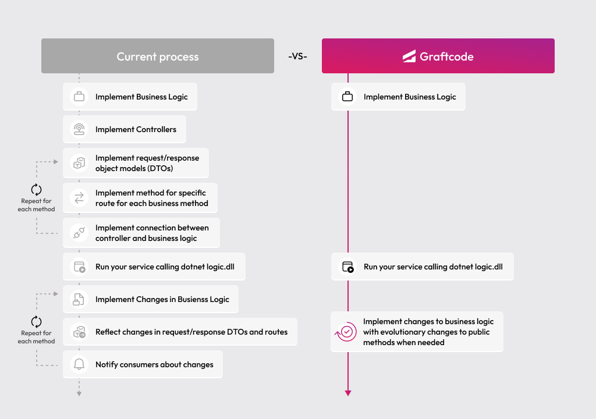

## Goal

Connect a PHP backend service to another remote service using Graftcode - so the remote integration stays strongly typed and reads like a normal method call.

### What You'll See

- Install a remote service as a strongly-typed Graft via Composer.
- Configure the generated client to point at the remote host.
- Call a remote method from your own service logic as if it were a local class.
- Use IDE autocompletion on the remote service's methods and classes.

### Prerequisites

- [PHP 7.4 or 8.0+](https://www.php.net/downloads) and [Composer](https://getcomposer.org/) installed locally

## Step 1. Create a PHP service

Create a new project folder for your backend service:

```bash
mkdir php-energy-consumer
cd php-energy-consumer
```

## Step 2. Find the remote method in Graftcode Vision

We're hosting this sample service for you so you can see exactly what connecting to another team's service looks like in practice - open it in [Graftcode Vision](https://g-d-ca-polc-demo-ecbe-01.nicedesert-fa74799d.polandcentral.azurecontainerapps.io) to explore.

Graftcode Vision shows all public classes and methods exposed by the remote service - their names, parameter types, and return types. It also gives you the exact package manager command needed to install that service as a Graft.

## Step 3. Install the Graft

Open [Graftcode Vision](https://g-d-ca-polc-demo-ecbe-01.nicedesert-fa74799d.polandcentral.azurecontainerapps.io), pick `Composer`, and copy the generated install command.

Create `composer.json`:

```json
{
    "name": "example/energy-consumer",
    "require": {
        "php": "^7.4 || ^8.0",
        "hypertube/php-sdk": "*",
        "graft/nuget-energypriceservice": "1.2.0"
    },
    "repositories": [
        {
            "type": "composer",
            "url": "https://grft.dev/composer/4b4e411f-60a0-4868-b8a6-46f5dee07448__free"
        }
    ],
    "scripts": {
        "post-install-cmd": [
            "@post-update-cmd"
        ],
        "post-update-cmd": [
            "@php vendor/graftcode/hypertube-php-sdk/scripts/download-lfs-files.php",
            "@php vendor/graftcode/hypertube-php-sdk/scripts/extract-zip-packages.php"
        ]
    }
}
```

```bash
composer install
```

Composer runs the Hypertube post-install scripts above to download Git LFS binaries and extract SDK packages into `vendor/graftcode/hypertube-php-sdk/hypertube/` (requires `ext-zip`, `ext-ffi`, and network access).

This adds the generated strongly-typed client for the remote service to your project.

## Step 4. Call the remote method and run it

The exact configuration snippet for your language is available in [Graftcode Vision](https://g-d-ca-polc-demo-ecbe-01.nicedesert-fa74799d.polandcentral.azurecontainerapps.io) under the **Configuration** installation tab. Create `index.php`:

```php
<?php

declare(strict_types=1);

require __DIR__ . '/vendor/autoload.php';

use Graft\Nuget\Energypriceservice\GraftConfig;
use Graft\Nuget\Energypriceservice\MeterLogic;

GraftConfig::$host = 'wss://g-d-ca-polc-demo-ecbe-01.nicedesert-fa74799d.polandcentral.azurecontainerapps.io/ws';

$consumption = MeterLogic::netConsumptionKWh(1000, 1150);
echo sprintf('Net consumption: %d', $consumption), PHP_EOL;
```

Run it:

```bash
php index.php
```

The Composer Graft typically exposes **camelCase** method names (`netConsumptionKWh`), even when Vision shows PascalCase from the .NET backend. Always prefer the import paths and member names from Vision or the installed package.

You should see the net consumption value printed in your terminal. `MeterLogic::netConsumptionKWh(...)` is a remote call, but your code reads like a normal method invocation - no HTTP request, no response parsing, no serialization.

Your IDE can autocomplete available methods on `MeterLogic`, `BillingLogic`, and any other class from that service because the Graft is a real installed package.

## Step 5. Run with a Project Key (recommended for real-world usage)

Everything above works without any account - perfect for learning and local development. When you're ready for real-world usage, create a free account at [portal.graftcode.com](https://portal.graftcode.com), set up a project, and copy its **Project Key**.

With a Project Key, point `GraftConfig::$host` at your project's stable registry URL instead of a raw WebSocket address. A Project Key gives you:

- **Stable registry URL** - the address for your Grafts stays permanent, so install commands don't change when you redeploy.
- **Portal visibility** - see all your gateways and services in one place at [gateways.graftcode.com](https://gateways.graftcode.com/).
- **Access control** - decide who can download your Grafts using package manager authentication and permissions.

<collapsible title="Old Way vs New Way">

### Without Graftcode

Connecting one backend service to another typically requires:

- Designing and implementing REST or gRPC endpoints in the remote service
- Defining request/response DTOs for every operation
- Writing or generating an OpenAPI or Protobuf spec
- Building or generating a client SDK in the consuming service's language
- Manually keeping both sides in sync when signatures change
- Adding error handling, retry logic, and serialization code

### With Graftcode

- Install the remote service as a strongly-typed Graft via `composer require`
- Import its classes and call methods directly - no REST client code
- When the remote service changes, update with one command - like any other package

> Connecting two backend services with Graftcode is as simple as installing a Composer package. No REST routes, no DTOs, no client generation - just import and call.



</collapsible>
