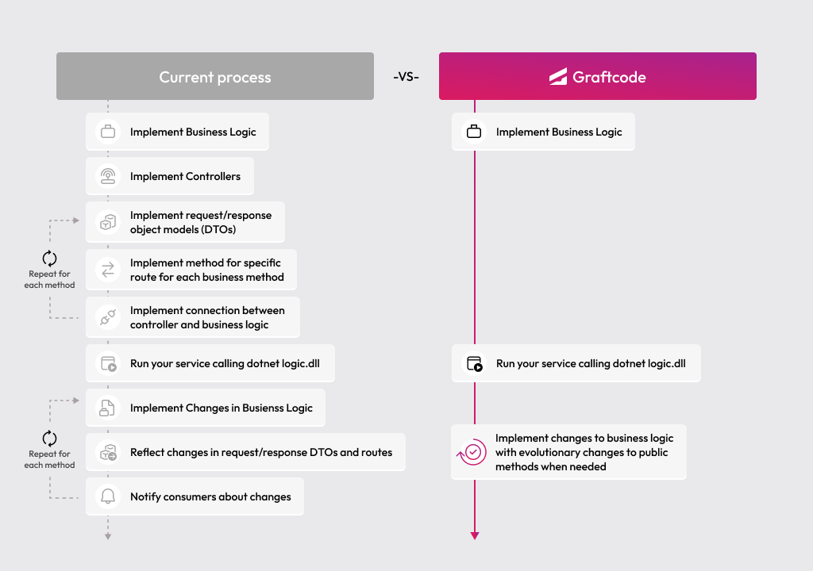

## Goal

Connect a Ruby backend service to another remote service using Graftcode - so the remote integration stays strongly typed and reads like a normal method call.

### What You'll See

- Install a remote service as a strongly-typed Graft via RubyGems (and Bundler).
- Configure the generated client to point at the remote host.
- Call a remote method from your own service logic as if it were a local class.
- Use IDE autocompletion on the remote service's methods and classes.

### Prerequisites

- [Ruby](https://www.ruby-lang.org/en/downloads/) (3.2 or newer recommended) and [Bundler](https://bundler.io/) installed locally

## Step 1. Create a Ruby service

Create a new project folder for your backend service:

```bash
mkdir ruby-energy-consumer
cd ruby-energy-consumer
```

## Step 2. Find the remote method in Graftcode Vision

We're hosting this sample service for you so you can see exactly what connecting to another team's service looks like in practice - open it in [Graftcode Vision](https://g-d-ca-polc-demo-ecbe-01.nicedesert-fa74799d.polandcentral.azurecontainerapps.io) to explore.

Graftcode Vision shows all public classes and methods exposed by the remote service - their names, parameter types, and return types. It also gives you the exact package manager command needed to install that service as a Graft.

## Step 3. Install the Graft

Open [Graftcode Vision](https://g-d-ca-polc-demo-ecbe-01.nicedesert-fa74799d.polandcentral.azurecontainerapps.io), pick **RubyGems**, and copy the generated install command.

Add a `Gemfile` that pulls the Graft from the registry URL Vision shows. **Copy the complete `gem` line from Vision** when you connect to your own gateway. For this tutorial’s public **EnergyPriceService** (.NET-hosted) sample, the RubyGems package is:

```bash
gem install graft-nuget-energypriceservice -v "1.3.0" --source https://grft.dev/d7bfad98-62f3-4b23-bf7b-b732fc9baf18__free
```

With Bundler, use the same registry, gem name, and version:

```ruby
# frozen_string_literal: true

source "https://rubygems.org"

source "https://grft.dev/d7bfad98-62f3-4b23-bf7b-b732fc9baf18__free" do
  gem "graft-nuget-energypriceservice", "1.3.0"
end
```

```bash
bundle install
```

The `gem` name, version, and `source` URL must match Vision exactly - Graftcode publishes a private feed per gateway when you run without a Project Key.

This adds the generated strongly-typed client for the remote service to your project.

## Step 4. Call the remote method and run it

The exact configuration snippet for Ruby is available in [Graftcode Vision](https://g-d-ca-polc-demo-ecbe-01.nicedesert-fa74799d.polandcentral.azurecontainerapps.io) under the **Configuration** installation tab. Create `main.rb`:

```ruby
# frozen_string_literal: true

require "bundler/setup"
require "graft_nuget_energypriceservice" # underscores: match the installed gem; Vision is authoritative if it differs

GraftConfig.host =
  "wss://g-d-ca-polc-demo-ecbe-01.nicedesert-fa74799d.polandcentral.azurecontainerapps.io/ws"

consumption = MeterLogic.net_consumption_k_wh(1000, 1150)
puts "Net consumption: #{consumption}"
```

Run it:

```bash
ruby main.rb
```

Prefer the `require` string, class names, and method names from Vision or the installed gem - Ruby Grafts often expose **snake_case** method names (for example `net_consumption_k_wh`), even when the originating service uses PascalCase.

You should see the net consumption value printed in your terminal. `MeterLogic.net_consumption_k_wh(...)` is a remote call, but your code reads like an ordinary method - no HTTP client, no response parsing, no manual serialization.

Your IDE can autocomplete methods on `MeterLogic`, `BillingLogic`, and other generated types because the Graft is a real installed gem.

## Step 5. Run with a Project Key (recommended for real-world usage)

Everything above works without any account - perfect for learning and local development. When you're ready for real-world usage, create a free account at [portal.graftcode.com](https://portal.graftcode.com), set up a project, and copy its **Project Key**.

With a Project Key, point `GraftConfig.host` at your project's stable WebSocket endpoint instead of a raw demo URL. A Project Key gives you:

- **Stable registry URL** - the address for your Grafts stays permanent, so install commands don't change when you redeploy.
- **Portal visibility** - see all your gateways and services in one place at [gateways.graftcode.com](https://gateways.graftcode.com/).
- **Access control** - decide who can download your Grafts using package manager authentication and permissions.

<collapsible title="Old Way vs New Way">

### Without Graftcode

Connecting one backend service to another typically requires:

- Designing and implementing REST or gRPC endpoints in the remote service
- Defining request/response DTOs for every operation
- Writing or generating an OpenAPI or Protobuf spec
- Building or generating a client SDK in the consuming service's language
- Manually keeping both sides in sync when signatures change
- Adding error handling, retry logic, and serialization code

### With Graftcode

- Install the remote service as a strongly-typed Graft with `gem` / Bundler
- Import its modules and call methods directly - no REST client code
- When the remote service changes, update with one command - like any other dependency

> Connecting two backend services with Graftcode is as simple as adding a Ruby gem. No REST routes, no DTOs, no client generation - just `require` and call.



</collapsible>
